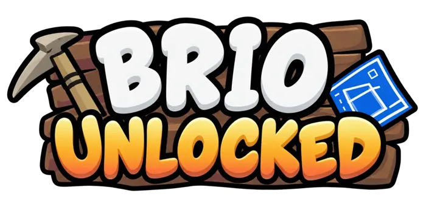
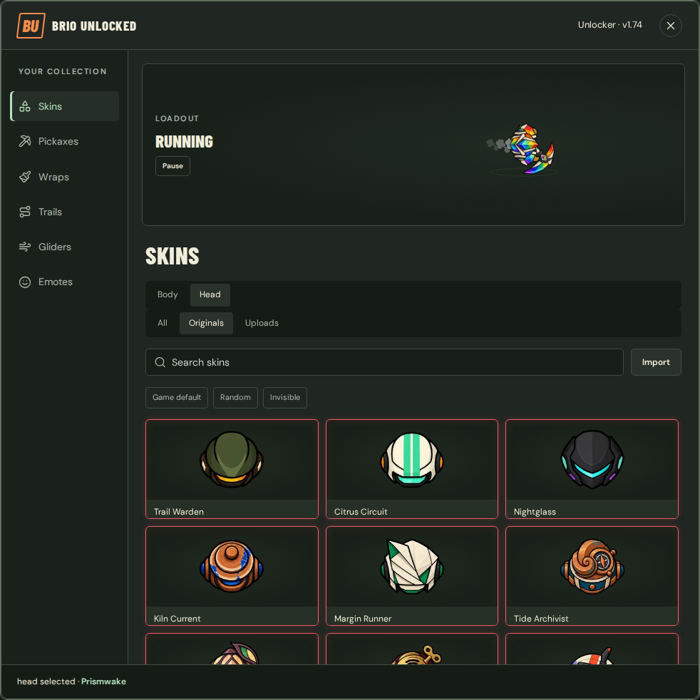
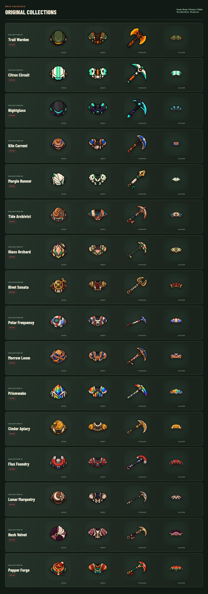
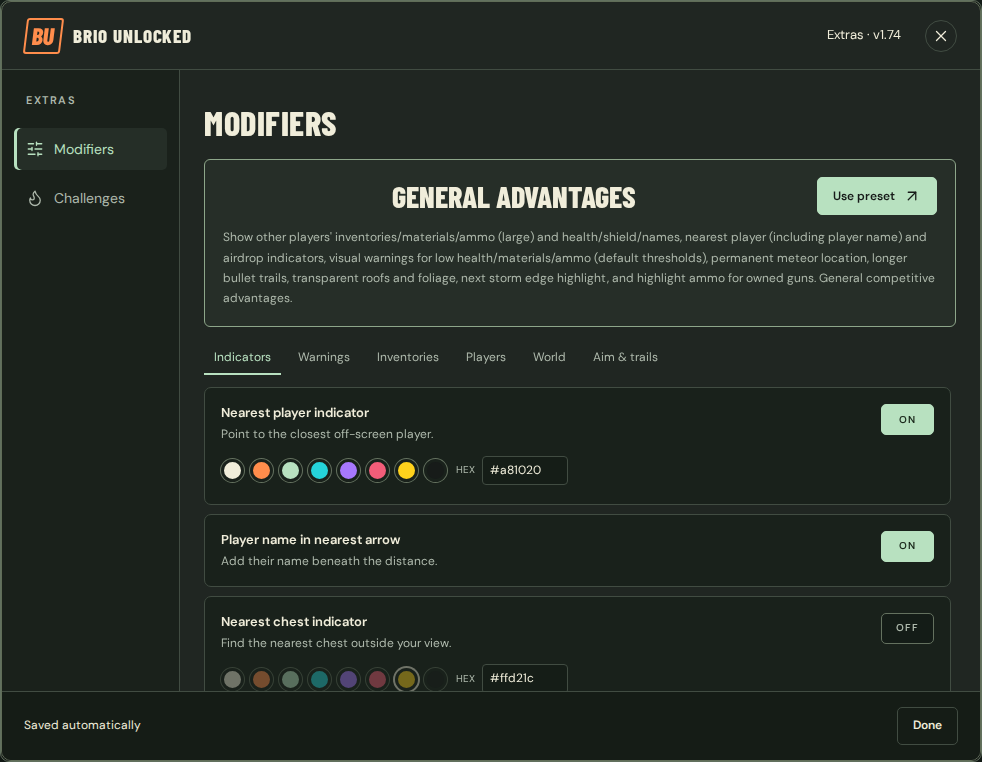
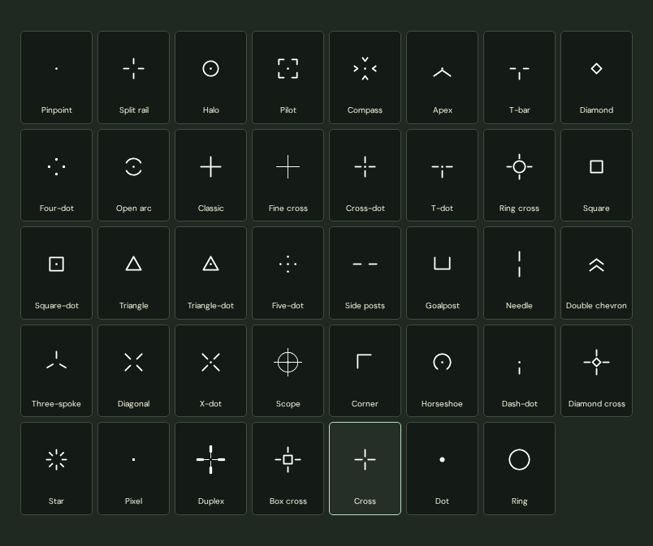
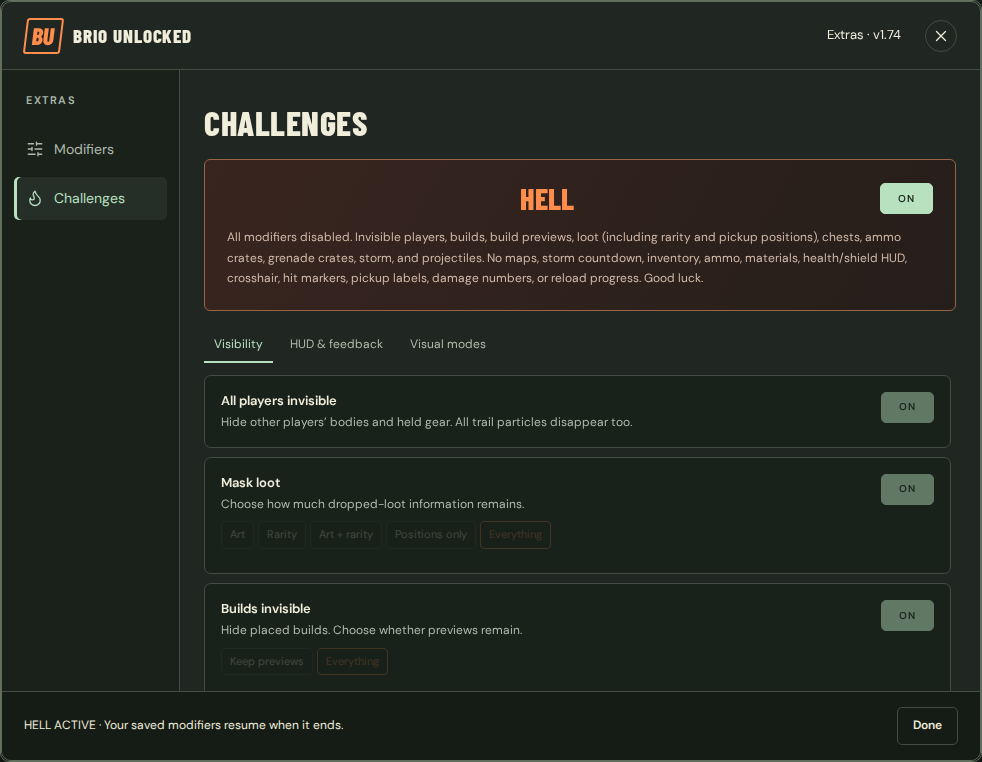
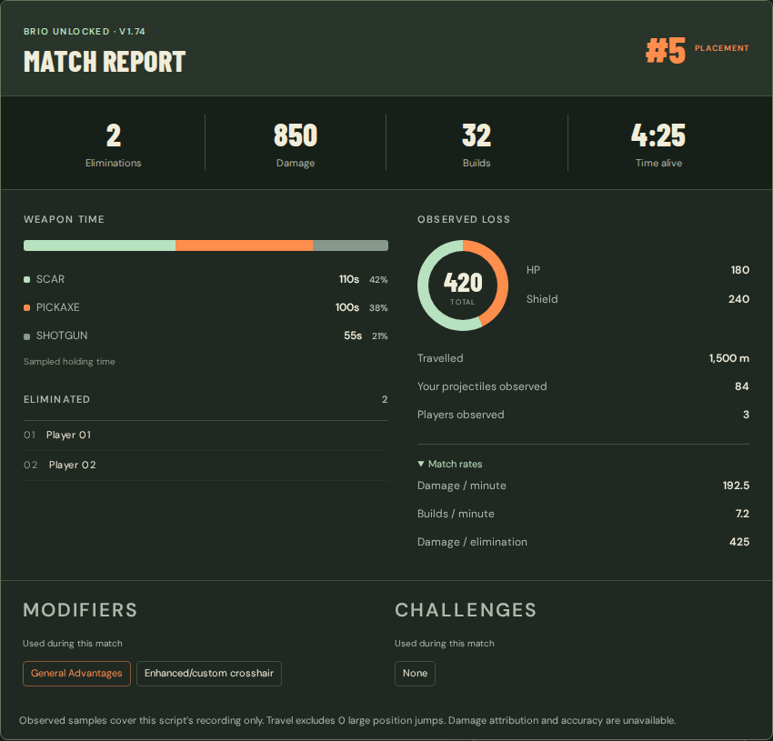
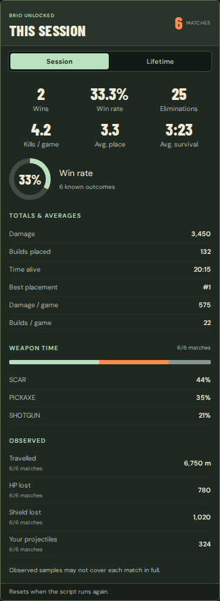
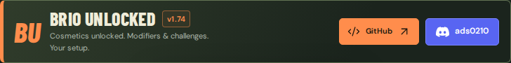

# BRIO UNLOCKED · v1.74

## Start here

1. Open **[Build Royale](https://buildroyale.io/)** and wait for home.
2. Install with **one** method below, before playing.
3. Open **Unlocker** for cosmetics or **Extras** for modifiers/challenges, then use the native Play button.

### Run in the console

Open [brio_unlocked.js](./brio_unlocked.js), select **Raw**, copy the entire script, then paste and run it once in the game tab's browser console. Close the console. Review code before running it; run only on the intended game origin.

### Create a one-click bookmark

Open [brio_unlocked_bookmark.txt](./brio_unlocked_bookmark.txt), select **Raw**, and copy its complete single line. Create a bookmark named **BRIO UNLOCKED**, edit its URL field, replace the URL with that line and save. Click it with the game home page open.

The prefix is **javascript: with one colon**. The code is minified, comment-free and not URL-encoded. Paste into the bookmark's URL field, not the address bar, which may strip the prefix. Browser length/security restrictions vary; use the console method if a browser rejects the bookmark.

The console script includes the original artwork. The bookmarklet retrieves image data from this project's public script, so it needs a network connection. It reads the image bundle without running downloaded code. No GitHub sign-in is required.

Reloading removes the installation. Running it again replaces its own previous installation and resets session totals, preserving saved choices, imports and lifetime statistics. No in-match settings controls are supplied. Configure from home; reloading during a match leaves that match.

---

<strong>YOUR LOOK · YOUR SETUP · YOUR CHALLENGE</strong> Cosmetics, visual tools, challenge modes and match insight.

  

**A look inside BRIO UNLOCKED.** Images below are rendered from the actual menu components and original artwork. Example statistics are illustrative; these are previews, not captured matches. Scrollable statistics panels are expanded here to show their contents.

## Your toolkit

| LOOK | SEE | CHALLENGE | REVIEW |
|---|---|---|---|
| Native catalogue, original sets and imports | Indicators, warnings and player information | Individual visibility/HUD challenges and HELL | Match, session and lifetime statistics |

## Unlocker

The native catalogue is read when the menu renders. Newly added game cosmetics can therefore appear dynamically. Search and filters help navigate it.

| Category | What you can choose |
|---|---|
| Skins | Separate heads and bodies, running loadout preview |
| Pickaxes | Held art and native inventory representation |
| Wraps | Native wraps, with a wrapped weapon preview |
| Trails | Native cosmetic trails and trailing preview |
| Gliders | Native choices and original plain gliders |
| Emotes | Four independent slots |

Default, random and invisible modes are offered where supported. Import images for heads, bodies and pickaxes. Imports stay in browser storage; BRIO does not upload them. Crosshair imports are separate PNG/WebP settings. Original custom wraps are not supplied.

### Sixteen original collections

## Modifiers

Modifiers affect local presentation. Indicator arrows follow observed off-screen targets, show metres, use configurable colors and keep labels upright. Optional player names are at least as tall as the distance label.

### General Advantages

Show other players' inventories/materials/ammo (large) and health/shield/names, nearest player (including player name) and airdrop indicators, visual warnings for low health/materials/ammo (default thresholds), permanent meteor location, longer bullet trails, transparent roofs and foliage, next storm edge highlight, and highlight ammo for owned guns. General competitive advantages.

**Use preset** selects exactly 18 modifier toggles, clears other modifier toggles, selects Large inventories, restores warning defaults and turns HELL off. Every setting remains editable. Glider hiding remains independent. Reports collapse an intact preset plus extras; removing a member expands individual used modifiers.

| Modifier | Function |
|---|---|
| **Transparent roofs** | See beneath roofs without losing the building outline. |
| **Player health bars** | Keep other players’ health in view. |
| **Health/shield numbers** | Show exact health and shield values inside the bars. |
| **Player names** | Show names above other players. |
| **All gliders invisible** | Hide glider artwork for you and other players. |
| **All trails invisible** | Hide cosmetic trails for everyone. |
| **Nearest player indicator** | Point to the closest off-screen player. |
| **Player name in nearest arrow** | Add their name beneath the distance. |
| **Nearest chest indicator** | Find the nearest chest outside your view. |
| **Nearest airdrop indicator** | Keep the nearest off-screen airdrop in sight. |
| **Permanent meteor location** | Keep the meteor marked for the rest of the match. |
| **High-contrast players** | Add a yellow halo around visible players. |
| **Transparent foliage** | See through leafy cover without removing it. |
| **Storm edge highlight** | Trace the next safe zone, matching the minimap. |
| **Safe-zone center direction** | Point toward the center of the next safe zone. |
| **Build health outlines** | Read remaining build health at a glance. |
| **Breakable object health outlines** | Color-code the health of breakable objects and vehicles. |
| **Nearest safe-zone edge** | Find the closest edge of the next safe zone. |
| **Loot indicator** | Point to your selected gold and red weapon drops. |
| **Highlight ammo for owned guns** | Outline ammo that fits a weapon you carry. |
| **Longer bullet trails** | Briefly retain trails from observed projectiles. |
| **Enhanced/custom crosshair** | Choose a shape, color and size that feels right. |
| **Low-health visual warning** | Flash a warning around you at or below the limit. |
| **Low-ammo visual warning** | Warn on each carried weapon’s inventory slot. |
| **Low-material warning** | Warn on each material counter when supplies run low. |
| **Inventory: 5 item slots** | See other players’ carried items. |
| **Inventory: build materials/counts** | Show their wood, brick, metal and scraps. |
| **Inventory: ammo by type** | Show their ammo and grappler charges. |
| **Inventory size** | Choose Small, Medium, Large or XL for other-player inventory displays. |

Warnings trigger at or below their thresholds. Defaults: **health 20**; Light/Medium/Heavy/Shells/Rockets/Grappler ammo **30/30/10/15/5/5**; Wood/Brick/Metal/Scraps **30/30/30/1**. Reset controls restore defaults. Signal flare is exempt from ammo warnings.

Loot choices use evenly arranged weapon cards. Grappler, MIRV and signal flare have no rarity rows. Vector, heavy sniper, minigun, grenade launcher, grenade pistol, crossbow and drum are Red-only when present. Other eligible guns retain Gold/Red choices. This locates observed pickups, not unopened contents.

### Crosshairs

Choose from **39 inline designs**, including Cross, Dot and Ring. Set color and size or import PNG/WebP art. Hit-marker visibility remains independently controlled.

## Challenges

Individual challenges can be combined. Status announcements and kill feed remain visible; No map also hides the numeric storm countdown, while separate storm/event text remains visible.

| Challenge | Function |
|---|---|
| **All players invisible** | Hide other players’ bodies and held gear. All trail particles disappear too. |
| **Mask loot** | Choose how much dropped-loot information remains. |
| **Builds invisible** | Hide placed builds. Choose whether previews remain. |
| **No map** | Hide the minimap, full map, map counters and numeric storm countdown. Status announcements remain visible. |
| **No crosshair** | Remove the crosshair and hit marker. |
| **No inventory/item bar** | Hide your item bar, materials, ammo counters and HUD name. |
| **Invisible storm** | Hide storm shading and zone borders in the world and on maps. |
| **Chests invisible** | Hide chests, ammo crates and grenade crates. |
| **No health/shield HUD** | Hide your health and shield bars. Keep the current ammo counter. |
| **Hide interaction prompts** | Hide build, inventory and interaction instructions. |
| **No pickup labels** | Hide nearby item labels. Keep the loot itself visible. |
| **No hit-confirmation marker** | Hide hit confirmations. Keep the crosshair. |
| **Hide damage direction** | Hide where incoming damage came from. |
| **No floating damage numbers** | Remove floating damage and healing numbers. |
| **No reload/charge progress** | Hide reload and charge indicators. |
| **Invisible bullets/throwables** | Hide bullets, throwables and their detached trails. |
| **Hide weapons** | Hide held weapons and aiming build previews. |
| **Monochrome vision** | Trade all colors for black and white. |
| **Flashlight mode** | Keep a soft pool of visibility around you or your cursor. |
| **Hell** | Enable every gameplay challenge at its highest masking tier and disable modifiers. |

### HELL

All modifiers disabled. Invisible players, builds, build previews, loot (including rarity and pickup positions), chests, ammo crates, grenade crates, storm, and projectiles. No maps, storm countdown, inventory, ammo, materials, health/shield HUD, crosshair, hit markers, pickup labels, damage numbers, or reload progress. Good luck.

HELL enforces its gameplay challenges and disables modifiers while active. Saved modifiers resume when it ends. Monochrome and flashlight remain independent visual choices.

### Tiered masking

| Loot tier | Presentation |
|---|---|
| Art | Item artwork hidden; rarity cues remain |
| Rarity | Rarity cues hidden; artwork remains |
| Art + rarity | Both cues hidden |
| Positions only | Pickup cues reduced to locations |
| Everything | Loot presentation and positions hidden |

Build masking can preserve placement previews or hide both builds and previews. Flashlight follows player or cursor, preserves the own HUD/status layer and fades out after a result.

## Match, session and lifetime insight

The match report augments the native result panel: placement, eliminations, damage, builds and survival time when supplied, plus observed weapon time, movement, loss and projectile/player samples. Used-modifier/challenge lists describe options used during the match, not proof of uninterrupted challenge enforcement.

The home dashboard switches between **THIS SESSION** and **LIFETIME**. Both use identical panels, formatting and charts: wins, win rate, eliminations, kills/game, placement and survival averages, damage/build totals and averages, best placement, weapon holding-time distribution and observed travel/loss/projectiles. Missing data uses coverage denominators rather than fabricated results.

Lifetime totals are stored locally in your browser using a small, fixed set of counters. Completed match histories and other players’ names are not saved. Rates use the results actually observed; missing data is not invented. Lifetime counting starts when the script first records a result; earlier games are not reconstructed.

Session resets on rerun. Lifetime survives rerun/reload on the same game origin and browser profile. Clearing site data, private browsing, a different browser/profile or blocked storage can reset/prevent persistence. Simultaneous tabs use best-effort merging, not a transactional account-wide database. Statistics are local convenience data, not verified records.

## Home screen

Ads are replaced by socials, statistics and a scrollable changelog. Play, party controls and result controls stay in their familiar places.

## Troubleshooting and scope

- The native game must remain reachable. The readable release contains original/logo/icon artwork; the bookmark retrieves those data from the public readable release.
- Cosmetic changes are local presentation, not an official purchase or a guarantee of what other clients see.
- If a native game update breaks compatibility, report the visible menu-footer error and browser version.
- Indicators use information the game already supplies. They do not reveal unopened-container contents, identify bots or predict weapon spread.
- Preference/import and lifetime persistence depends on browser site storage. Export/backup/sync is not provided.

## v1.74 — What's included

- First public release of BRIO UNLOCKED.
- Unlocker with the live game's cosmetic catalogue, running loadout preview, search, random and invisible choices, and four emote slots.
- Sixteen original head, body, pickaxe and glider sets; native wraps and trails; image imports for heads, bodies and pickaxes. Rarity-colored cosmetic cards.
- Directional player, chest, airdrop, selected-loot and safe-zone indicators with distances and configurable colors; optional player-name labels.
- Other-player inventories, materials, ammo, names, health and shield displays with adjustable inventory size and optional high-contrast player outlines.
- Configurable low-health, ammo and material warnings; transparent roofs and foliage; build and object health outlines.
- Projected next-storm edge highlight, permanent meteor marker, ammo highlighting, longer bullet trails and optional invisible gliders or trails.
- Thirty-nine crosshair designs with color and size controls, plus PNG/WebP crosshair imports.
- Editable General Advantages preset: selects its complete recommended configuration and clears other modifiers.
- Visibility challenges for players, loot, builds, storm, chests, ammo/grenade crates, weapons and projectiles. Tiered loot/build masking.
- HUD challenges for maps/storm countdown, inventory/ammo/materials, health/shield, crosshair, interaction/pickup labels, hit markers, damage direction/numbers and reload/charge progress. HELL combines the gameplay challenges and disables modifiers; status announcements and kill feed remain visible.
- Monochrome and flashlight challenges; flashlight follows the player or cursor and fades smoothly after a match.
- Match report with native results, observed statistics, charts and the modifiers/challenges used; session and browser-local lifetime totals, averages, wins and win rate.
- Home-page ad suppression, BRIO branding and socials, session dashboard and this scrollable changelog.
- Saved cosmetic and Extras preferences, owned-resource cleanup between matches, and safe replacement of a previous installation when run again.

**Project:** [BRIO UNLOCKED](https://github.com/shortcutsbin-netizen/brio_unlocked) · **Discord handle:** ads0210

## Third-party notices

Native Build Royale assets/branding belong to their owners. Included components: Acorn (MIT), Lucide icons (ISC), Barlow Condensed and DM Sans (SIL Open Font License). License texts follow.

LICENSE

~~~text
MIT License

Copyright (C) 2012-2022 by various contributors (see AUTHORS)

Permission is hereby granted, free of charge, to any person obtaining a copy
of this software and associated documentation files (the "Software"), to deal
in the Software without restriction, including without limitation the rights
to use, copy, modify, merge, publish, distribute, sublicense, and/or sell
copies of the Software, and to permit persons to whom the Software is
furnished to do so, subject to the following conditions:

The above copyright notice and this permission notice shall be included in
all copies or substantial portions of the Software.

THE SOFTWARE IS PROVIDED "AS IS", WITHOUT WARRANTY OF ANY KIND, EXPRESS OR
IMPLIED, INCLUDING BUT NOT LIMITED TO THE WARRANTIES OF MERCHANTABILITY,
FITNESS FOR A PARTICULAR PURPOSE AND NONINFRINGEMENT. IN NO EVENT SHALL THE
AUTHORS OR COPYRIGHT HOLDERS BE LIABLE FOR ANY CLAIM, DAMAGES OR OTHER
LIABILITY, WHETHER IN AN ACTION OF CONTRACT, TORT OR OTHERWISE, ARISING FROM,
OUT OF OR IN CONNECTION WITH THE SOFTWARE OR THE USE OR OTHER DEALINGS IN
THE SOFTWARE.

~~~

lucide-LICENSE.txt

~~~text
ISC License

Copyright (c) 2026 Lucide Icons and Contributors

Permission to use, copy, modify, and/or distribute this software for any
purpose with or without fee is hereby granted, provided that the above
copyright notice and this permission notice appear in all copies.

THE SOFTWARE IS PROVIDED "AS IS" AND THE AUTHOR DISCLAIMS ALL WARRANTIES
WITH REGARD TO THIS SOFTWARE INCLUDING ALL IMPLIED WARRANTIES OF
MERCHANTABILITY AND FITNESS. IN NO EVENT SHALL THE AUTHOR BE LIABLE FOR
ANY SPECIAL, DIRECT, INDIRECT, OR CONSEQUENTIAL DAMAGES OR ANY DAMAGES
WHATSOEVER RESULTING FROM LOSS OF USE, DATA OR PROFITS, WHETHER IN AN
ACTION OF CONTRACT, NEGLIGENCE OR OTHER TORTIOUS ACTION, ARISING OUT OF
OR IN CONNECTION WITH THE USE OR PERFORMANCE OF THIS SOFTWARE.

---

The following Lucide icons are derived from the Feather project:

airplay, alert-circle, alert-octagon, alert-triangle, aperture, arrow-down-circle, arrow-down-left, arrow-down-right, arrow-down, arrow-left-circle, arrow-left, arrow-right-circle, arrow-right, arrow-up-circle, arrow-up-left, arrow-up-right, arrow-up, at-sign, calendar, cast, check, chevron-down, chevron-left, chevron-right, chevron-up, chevrons-down, chevrons-left, chevrons-right, chevrons-up, circle, clipboard, clock, code, columns, command, compass, corner-down-left, corner-down-right, corner-left-down, corner-left-up, corner-right-down, corner-right-up, corner-up-left, corner-up-right, crosshair, database, divide-circle, divide-square, dollar-sign, download, external-link, feather, frown, hash, headphones, help-circle, info, italic, key, layout, life-buoy, link-2, link, loader, lock, log-in, log-out, maximize, meh, minimize, minimize-2, minus-circle, minus-square, minus, monitor, moon, more-horizontal, more-vertical, move, music, navigation-2, navigation, octagon, pause-circle, percent, plus-circle, plus-square, plus, power, radio, rss, search, server, share, shopping-bag, sidebar, smartphone, smile, square, table-2, tablet, target, terminal, trash-2, trash, triangle, tv, type, upload, x-circle, x-octagon, x-square, x, zoom-in, zoom-out

The MIT License (MIT) (for the icons listed above)

Copyright (c) 2013-present Cole Bemis

Permission is hereby granted, free of charge, to any person obtaining a copy
of this software and associated documentation files (the "Software"), to deal
in the Software without restriction, including without limitation the rights
to use, copy, modify, merge, publish, distribute, sublicense, and/or sell
copies of the Software, and to permit persons to whom the Software is
furnished to do so, subject to the following conditions:

The above copyright notice and this permission notice shall be included in all
copies or substantial portions of the Software.

THE SOFTWARE IS PROVIDED "AS IS", WITHOUT WARRANTY OF ANY KIND, EXPRESS OR
IMPLIED, INCLUDING BUT NOT LIMITED TO THE WARRANTIES OF MERCHANTABILITY,
FITNESS FOR A PARTICULAR PURPOSE AND NONINFRINGEMENT. IN NO EVENT SHALL THE
AUTHORS OR COPYRIGHT HOLDERS BE LIABLE FOR ANY CLAIM, DAMAGES OR OTHER
LIABILITY, WHETHER IN AN ACTION OF CONTRACT, TORT OR OTHERWISE, ARISING FROM,
OUT OF OR IN CONNECTION WITH THE SOFTWARE OR THE USE OR OTHER DEALINGS IN THE
SOFTWARE.

~~~

barlow-OFL.txt

~~~text
Copyright 2017 The Barlow Project Authors (https://github.com/jpt/barlow)

This Font Software is licensed under the SIL Open Font License, Version 1.1.
This license is copied below, and is also available with a FAQ at:
http://scripts.sil.org/OFL

-----------------------------------------------------------
SIL OPEN FONT LICENSE Version 1.1 - 26 February 2007
-----------------------------------------------------------

PREAMBLE
The goals of the Open Font License (OFL) are to stimulate worldwide
development of collaborative font projects, to support the font creation
efforts of academic and linguistic communities, and to provide a free and
open framework in which fonts may be shared and improved in partnership
with others.

The OFL allows the licensed fonts to be used, studied, modified and
redistributed freely as long as they are not sold by themselves. The
fonts, including any derivative works, can be bundled, embedded,
redistributed and/or sold with any software provided that any reserved
names are not used by derivative works. The fonts and derivatives,
however, cannot be released under any other type of license. The
requirement for fonts to remain under this license does not apply
to any document created using the fonts or their derivatives.

DEFINITIONS
"Font Software" refers to the set of files released by the Copyright
Holder(s) under this license and clearly marked as such. This may
include source files, build scripts and documentation.

"Reserved Font Name" refers to any names specified as such after the
copyright statement(s).

"Original Version" refers to the collection of Font Software components as
distributed by the Copyright Holder(s).

"Modified Version" refers to any derivative made by adding to, deleting,
or substituting -- in part or in whole -- any of the components of the
Original Version, by changing formats or by porting the Font Software to a
new environment.

"Author" refers to any designer, engineer, programmer, technical
writer or other person who contributed to the Font Software.

PERMISSION & CONDITIONS
Permission is hereby granted, free of charge, to any person obtaining
a copy of the Font Software, to use, study, copy, merge, embed, modify,
redistribute, and sell modified and unmodified copies of the Font
Software, subject to the following conditions:

1) Neither the Font Software nor any of its individual components,
in Original or Modified Versions, may be sold by itself.

2) Original or Modified Versions of the Font Software may be bundled,
redistributed and/or sold with any software, provided that each copy
contains the above copyright notice and this license. These can be
included either as stand-alone text files, human-readable headers or
in the appropriate machine-readable metadata fields within text or
binary files as long as those fields can be easily viewed by the user.

3) No Modified Version of the Font Software may use the Reserved Font
Name(s) unless explicit written permission is granted by the corresponding
Copyright Holder. This restriction only applies to the primary font name as
presented to the users.

4) The name(s) of the Copyright Holder(s) or the Author(s) of the Font
Software shall not be used to promote, endorse or advertise any
Modified Version, except to acknowledge the contribution(s) of the
Copyright Holder(s) and the Author(s) or with their explicit written
permission.

5) The Font Software, modified or unmodified, in part or in whole,
must be distributed entirely under this license, and must not be
distributed under any other license. The requirement for fonts to
remain under this license does not apply to any document created
using the Font Software.

TERMINATION
This license becomes null and void if any of the above conditions are
not met.

DISCLAIMER
THE FONT SOFTWARE IS PROVIDED "AS IS", WITHOUT WARRANTY OF ANY KIND,
EXPRESS OR IMPLIED, INCLUDING BUT NOT LIMITED TO ANY WARRANTIES OF
MERCHANTABILITY, FITNESS FOR A PARTICULAR PURPOSE AND NONINFRINGEMENT
OF COPYRIGHT, PATENT, TRADEMARK, OR OTHER RIGHT. IN NO EVENT SHALL THE
COPYRIGHT HOLDER BE LIABLE FOR ANY CLAIM, DAMAGES OR OTHER LIABILITY,
INCLUDING ANY GENERAL, SPECIAL, INDIRECT, INCIDENTAL, OR CONSEQUENTIAL
DAMAGES, WHETHER IN AN ACTION OF CONTRACT, TORT OR OTHERWISE, ARISING
FROM, OUT OF THE USE OR INABILITY TO USE THE FONT SOFTWARE OR FROM
OTHER DEALINGS IN THE FONT SOFTWARE.

~~~

dm-sans-OFL.txt

~~~text
Copyright 2014 The DM Sans Project Authors (https://github.com/googlefonts/dm-fonts)

This Font Software is licensed under the SIL Open Font License, Version 1.1.
This license is copied below, and is also available with a FAQ at:
https://scripts.sil.org/OFL

-----------------------------------------------------------
SIL OPEN FONT LICENSE Version 1.1 - 26 February 2007
-----------------------------------------------------------

PREAMBLE
The goals of the Open Font License (OFL) are to stimulate worldwide
development of collaborative font projects, to support the font creation
efforts of academic and linguistic communities, and to provide a free and
open framework in which fonts may be shared and improved in partnership
with others.

The OFL allows the licensed fonts to be used, studied, modified and
redistributed freely as long as they are not sold by themselves. The
fonts, including any derivative works, can be bundled, embedded,
redistributed and/or sold with any software provided that any reserved
names are not used by derivative works. The fonts and derivatives,
however, cannot be released under any other type of license. The
requirement for fonts to remain under this license does not apply
to any document created using the fonts or their derivatives.

DEFINITIONS
"Font Software" refers to the set of files released by the Copyright
Holder(s) under this license and clearly marked as such. This may
include source files, build scripts and documentation.

"Reserved Font Name" refers to any names specified as such after the
copyright statement(s).

"Original Version" refers to the collection of Font Software components as
distributed by the Copyright Holder(s).

"Modified Version" refers to any derivative made by adding to, deleting,
or substituting -- in part or in whole -- any of the components of the
Original Version, by changing formats or by porting the Font Software to a
new environment.

"Author" refers to any designer, engineer, programmer, technical
writer or other person who contributed to the Font Software.

PERMISSION & CONDITIONS
Permission is hereby granted, free of charge, to any person obtaining
a copy of the Font Software, to use, study, copy, merge, embed, modify,
redistribute, and sell modified and unmodified copies of the Font
Software, subject to the following conditions:

1) Neither the Font Software nor any of its individual components,
in Original or Modified Versions, may be sold by itself.

2) Original or Modified Versions of the Font Software may be bundled,
redistributed and/or sold with any software, provided that each copy
contains the above copyright notice and this license. These can be
included either as stand-alone text files, human-readable headers or
in the appropriate machine-readable metadata fields within text or
binary files as long as those fields can be easily viewed by the user.

3) No Modified Version of the Font Software may use the Reserved Font
Name(s) unless explicit written permission is granted by the corresponding
Copyright Holder. This restriction only applies to the primary font name as
presented to the users.

4) The name(s) of the Copyright Holder(s) or the Author(s) of the Font
Software shall not be used to promote, endorse or advertise any
Modified Version, except to acknowledge the contribution(s) of the
Copyright Holder(s) and the Author(s) or with their explicit written
permission.

5) The Font Software, modified or unmodified, in part or in whole,
must be distributed entirely under this license, and must not be
distributed under any other license. The requirement for fonts to
remain under this license does not apply to any document created
using the Font Software.

TERMINATION
This license becomes null and void if any of the above conditions are
not met.

DISCLAIMER
THE FONT SOFTWARE IS PROVIDED "AS IS", WITHOUT WARRANTY OF ANY KIND,
EXPRESS OR IMPLIED, INCLUDING BUT NOT LIMITED TO ANY WARRANTIES OF
MERCHANTABILITY, FITNESS FOR A PARTICULAR PURPOSE AND NONINFRINGEMENT
OF COPYRIGHT, PATENT, TRADEMARK, OR OTHER RIGHT. IN NO EVENT SHALL THE
COPYRIGHT HOLDER BE LIABLE FOR ANY CLAIM, DAMAGES OR OTHER LIABILITY,
INCLUDING ANY GENERAL, SPECIAL, INDIRECT, INCIDENTAL, OR CONSEQUENTIAL
DAMAGES, WHETHER IN AN ACTION OF CONTRACT, TORT OR OTHERWISE, ARISING
FROM, OUT OF THE USE OR INABILITY TO USE THE FONT SOFTWARE OR FROM
OTHER DEALINGS IN THE FONT SOFTWARE.

~~~

Discord glyph: Simple Icons (CC0-1.0). Discord is a trademark of its owner. The badge displays a handle and does not imply endorsement.
